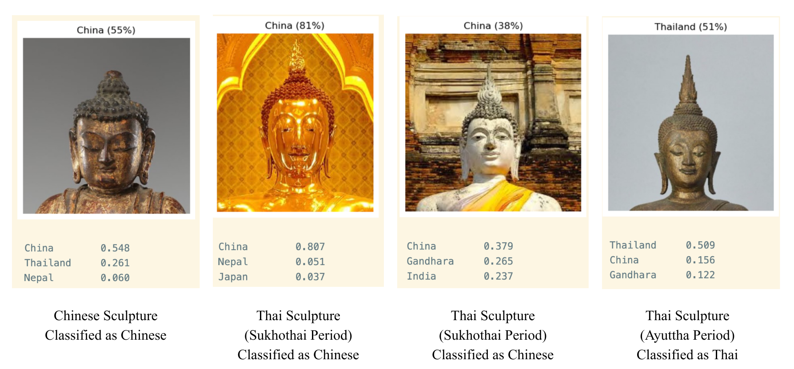

# DSAN 6000 Project: Sculpture Classification
### Fine-tuning a model to classified Buddhism sculpture by its origin
#### Author: Petra Chuenarrom

---
#### Check-in 1
---

## About the Project

(why this project and stuff)

### Defining Success

#### Task of the project

A multi-class image classification. The model will fine-tuning a pre-trained model on a dataset so it could take a photo of a Buddhist sculpture and predict origin by the art styles. 

**The success criteria are as follow**
- 75% success rate in classified the test set into the correct group.
  - This target might get adjusted after baseline test to be more realistic if needed. However, we aimed for the success rate to be more than 50%
- 50% success rate for each classification group individually.
  - There are some rare classes of Buddhism sculpture, such as sculpture from older civilization where we have less amount of artifacts. These classification of image into this class can be extremely misclassified but still not contribute a lot to the overall unsuccessful rate of entire dataset. So, we also set success expectation onto individual groups.
- There are patterns in errors
  - For classification that are unsuccessful, we should be able to see why. The reason should be in recognizable pattern that could furthermore fine-tuning the model in the future if more data is available, or be explainable with more knowledge about the artifacts. 

### Scope of the Project

- Data used for training and testing will only be from the online collection of museums and research centers. The classification will only covered Buddhism in South Asia, East Asia, and Southeast Asia due to the inadequate amount of data from other regions.
- The project aimed to only classified by the region with no regards to the period. Sculptures from two historic civilizations will be classified as the same class if the present-day region is the same place.

## Dataset

### Dataset sources

The following are list of collection we have gathered images of sculptures. 
- Online collection
  - Tsz shan monastery buddhist art museum, Hong Kong
  - The Metropolitan Museum of Art, New York
  - Staatliche Museen zu Berlin, Germany
  - Rietberg Museum, Zurich, Switzerland
  - Tibet Museum, Gruyères, Switzerland
  - Asian Art Museum, San Francisco
  - National Museum of Asian Arts, Washington, D.C.
 
- Online Database
  - Online database ColBase by National Institutes for Cultural Heritage, Japan

### Access Dataset

Images are in folder ```image```. The data are images of Buddhism Sculpture across collections, named following the index in ```sculpturesData.csv```

### Notes on Artifacts Origin

It is noteworthy that though all collection are open-source, some of the artifacts are in the museums or private collections which had controversy over the legitimacy of artifact's origin. Some artifacts maybe under the request for repatriation to its home country due to the history of them being looted or illegally sold. Some museums and collections have refused repatriation or have histories of refusing repatriation. By using the data from their online collection, we do not support the refusal of repatriation for artifacts with illegitimate origin by any means. 

## Data Audit

### Summary of Data

After gathering all data and filter them to only Buddhism related data and removing, we have 1948 images across 10 classes. The distributions are as follows

| Origin | Number of Data |
| -------- | -------- |
| China    |801   |
| Myanmar  |304   |
|Thailand     |166|
|Japan        |135|
|India        |127|
|Gandhara     |122|
|Tibet        |107|
|Indonesia     |87|
|Nepal         |63|
|Cambodia      |36|

#### Bias

- Majority of dataset are artifacts in collection of museums in the United States or Europe which may favor a certain style more. For example, there will be more gold, decorated, undamaged sculptures than plain wooden ones. We can seek more balance in styles via sourcing from collection in Asia but there are also difference in image quality which can cause another bias as well.
- As we have noted in the previous section, some of the artifacts have ambiguity on its origin. As many of them have been sold through several hands, some are illegally, there existed cases where the museum or collection can not be certain of the origin

#### Failure Modes

- The model can classified not based on the art styles but on the materials, which is not the main goal for this project
  - Example: During the 13th Century, in area of present-day Thailand and Cambodia, it is common for Buddhist sculpture to be made of sandstone. The model might classified these correctly but with the wrong reason. Then, if we input the sandstone sculpture from China, the model could classified its origin as Thailand. 
- Influences of Culture
  - Example: Sculpture found in Thailand that are from around 3rd Century could be heavily influence by India or imported from India before they developed into their own art style. Influences of art styles can make misclassification happened.

---
#### Check-in 2
---

The model is currently using CNN Resnet-50 and fine-tuning it using our own dataset. In splitting dataset, we split each classes to ensure that every classes will have data for training, validating, and testing. The split distribution is as follows

|Origin |train  |val  |test|
|--- |---  |---  |---|      
|China        |480  |160   |161|
|Myanmar     |182  |60  |62|
|Thailand    |99  |33  |34|
|Japan       |81 |27 |27|
|India       |76 |25  |26|
|Gandhara     |73  |24  |25|
|Tibet        |64  |21  |22|
|Indonesia   |52 |17  |18|
|Nepal       |37  |12   |14|
|Cambodia    |21 |7   |8|

## Current Result

As mentioned, we want to have a success rate of at least 75% overall and at least 50% of each group. Currently, the success rate overall is 70.78%
and the accuracy percentage across each classes are as follows

|class  |      precision|
|---|---|
|Cambodia \*     |0.17|
|China         |0.81|
|Gandhara     |0.63|
|India          |0.50|
|Indonesia        |0.54|
|Japan    |0.67|
|Myanmar    |0.91|
|Nepal \*       |0.00|
|Thailand     |0.61|
|Tibet \*        |0.45|

\* is classes that fail precision expectation

## Failure Analysis

- Shape-focus
  - Currently the model is focusing on the outline shape more than the details. Thus, sculpture with similar outline shape get misclassified despite a strong difference in other details
  - Example: These two Thai sculpture has a more round-shape face (period-specific style), which is similar to Japanese-style sculpture. It get classified as a Japanese Sculpture.
    
  - Improvement Plan
    - Having another classification prior to origin classification. This new classification will group sculptures by parts (only head, only body, full sculpture, group sculpture). We hope that this additional classification will make the model able to learn the difference across origin classes better.
    - Improving Image cropping to have less outline being significant. 
- Speed
  - Currently CNN is taking about 1 hour to train on CPU, we will try to use Faster-CNN for check-in 3
